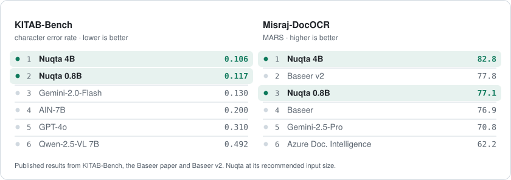

<picture>
  <source media="(prefers-color-scheme: dark)" srcset="assets/hero-dark.svg">
  
</picture>

Most of my time goes into [**Nuqta**](https://github.com/SalahAlHaismawi/nuqta-ocr), an open-source OCR model for Arabic. It reads books, tables, IDs and passports, keeps the tashkeel exactly as printed, and the small one runs offline on a phone. [Try it here.](https://huggingface.co/spaces/SalahALHaismawi/Nuqta-Arabic-OCR)

<picture>
  <source media="(prefers-color-scheme: dark)" srcset="assets/board-dark.svg">
  
</picture>

Other projects:
- [training-doctor](https://github.com/SalahAlHaismawi/training-doctor) catches silent training failures and tells you the fix
- [fire detection](https://github.com/SalahAlHaismawi/yolov26-fire-detection), a YOLO model at 94.9% mAP@50 with ~6k downloads
- [Talon](https://github.com/SalahAlHaismawi/Talon-D1-LLM), an LLM I wrote and trained from scratch

[LinkedIn](https://www.linkedin.com/in/salah-alhaismawi-a62696228/) · [Hugging Face](https://huggingface.co/SalahALHaismawi) · [salah322s1@gmail.com](mailto:salah322s1@gmail.com)

<picture>
  <source media="(prefers-color-scheme: dark)" srcset="https://raw.githubusercontent.com/SalahAlHaismawi/SalahAlHaismawi/output/snake-dark.svg">
  
</picture>
