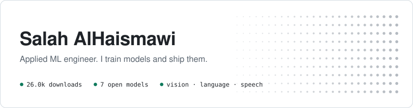
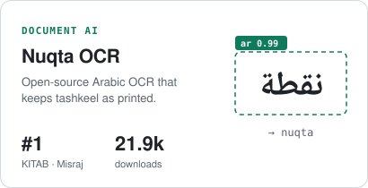
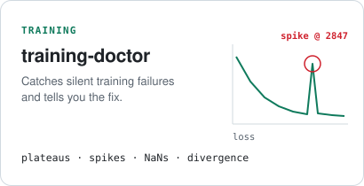
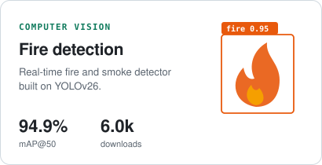
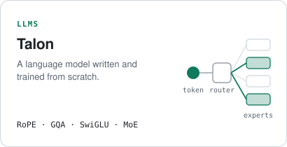

<picture>
  <source media="(prefers-color-scheme: dark)" srcset="assets/hero-dark.svg">
  
</picture>

<a href="https://github.com/SalahAlHaismawi/nuqta-ocr"><picture><source media="(prefers-color-scheme: dark)" srcset="assets/nuqta-dark.svg"></picture></a> <a href="https://github.com/SalahAlHaismawi/training-doctor"><picture><source media="(prefers-color-scheme: dark)" srcset="assets/doctor-dark.svg"></picture></a>
<a href="https://github.com/SalahAlHaismawi/yolov26-fire-detection"><picture><source media="(prefers-color-scheme: dark)" srcset="assets/fire-dark.svg"></picture></a> <a href="https://github.com/SalahAlHaismawi/Talon-D1-LLM"><picture><source media="(prefers-color-scheme: dark)" srcset="assets/talon-dark.svg"></picture></a>

I also fine-tune LLMs ([Falcon-H1R on UAE law](https://huggingface.co/SalahALHaismawi/falcon-h1r-uae-laws)) and build ASR and speaker diarization for code-switched audio.

[LinkedIn](https://www.linkedin.com/in/salah-alhaismawi-a62696228/) · [Hugging Face](https://huggingface.co/SalahALHaismawi) · [salah322s1@gmail.com](mailto:salah322s1@gmail.com)

<picture>
  <source media="(prefers-color-scheme: dark)" srcset="https://raw.githubusercontent.com/SalahAlHaismawi/SalahAlHaismawi/output/snake-dark.svg">
  
</picture>
