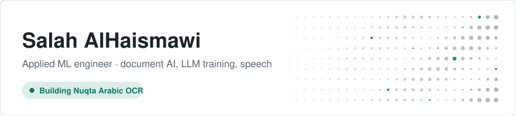
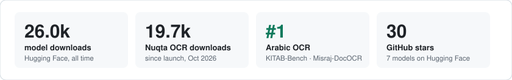
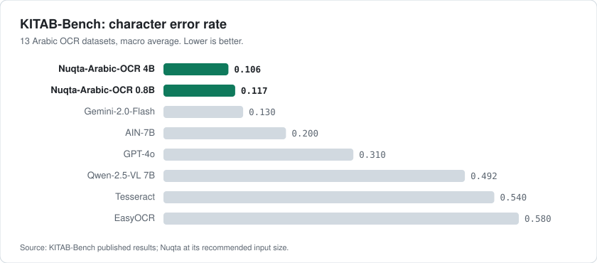
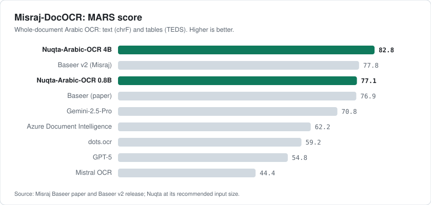
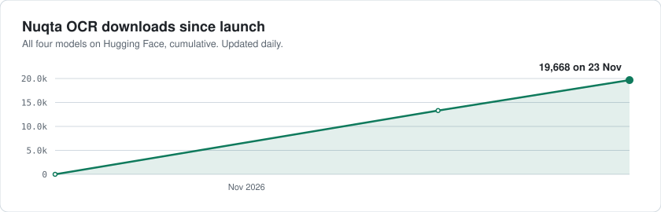

<picture>
  <source media="(prefers-color-scheme: dark)" srcset="assets/header-dark.svg">
  
</picture>

<p>
  <a href="https://www.linkedin.com/in/salah-alhaismawi-a62696228/"></a>
  <a href="https://huggingface.co/SalahALHaismawi"></a>
  <a href="mailto:salah322s1@gmail.com"></a>
  <a href="https://salahalhaismawi.github.io/nuqta-ocr/"></a>
</p>

<picture>
  <source media="(prefers-color-scheme: dark)" srcset="assets/stats-dark.svg">
  
</picture>

## Nuqta OCR

Open-source Arabic OCR. Two models, 0.8B and 4B, that read books, scans, tables, IDs and passports and keep the tashkeel exactly as printed. The 0.8B runs offline on a phone.

```bash
pip install nuqta-ocr
```

[Repository](https://github.com/SalahAlHaismawi/nuqta-ocr) · [Models](https://huggingface.co/SalahALHaismawi/Nuqta-Arabic-OCR-4B) · [Live demo](https://huggingface.co/spaces/SalahALHaismawi/Nuqta-Arabic-OCR) · [Benchmarks compared](https://salahalhaismawi.github.io/nuqta-ocr/best-arabic-ocr/) · [Raw benchmark outputs](https://huggingface.co/datasets/SalahALHaismawi/Arabic-OCR-benchmark-predictions)

<picture>
  <source media="(prefers-color-scheme: dark)" srcset="assets/kitab-dark.svg">
  
</picture>

<picture>
  <source media="(prefers-color-scheme: dark)" srcset="assets/misraj-dark.svg">
  
</picture>

<picture>
  <source media="(prefers-color-scheme: dark)" srcset="assets/downloads-dark.svg">
  
</picture>

Built on Nuqta by other developers: [Windows GUI](https://github.com/hadi4172/nuqta-ocr-gui) · [OCRmyPDF plugin](https://github.com/AbdoSol1iman/ocrmypdf-nuqta) · [handwritten invoice reader](https://github.com/OnlyAbdullh/HandwrittenInvoiceAI) · [handwriting OCR comparison](https://huggingface.co/spaces/BloodyWolf143/warraq-arabic-htr)

## Other work

- [**training-doctor**](https://github.com/SalahAlHaismawi/training-doctor): watches a training run and flags silent failures (plateaus, exploding gradients, diverging eval loss) with a fix for each.
- [**YOLOv26 fire detection**](https://github.com/SalahAlHaismawi/yolov26-fire-detection): real-time fire and smoke detector. 94.9% mAP@50 on 8,939 images, ~6k downloads on [Hugging Face](https://huggingface.co/SalahALHaismawi/yolov26-fire-detection).
- [**Talon**](https://github.com/SalahAlHaismawi/Talon-D1-LLM): a language model written and trained from scratch, with RoPE, GQA, SwiGLU and mixture of experts.
- [**Falcon-H1R UAE laws**](https://huggingface.co/SalahALHaismawi/falcon-h1r-uae-laws): Falcon-H1R-7B fine-tuned on UAE legislation.

## Stack


Transformers · vLLM · llama.cpp · CUDA/Triton · FSDP · Weights & Biases

## Contributions

<picture>
  <source media="(prefers-color-scheme: dark)" srcset="https://raw.githubusercontent.com/SalahAlHaismawi/SalahAlHaismawi/output/snake-dark.svg">
  
</picture>

<sub>Charts are generated by [scripts/build.py](scripts/build.py) from live Hugging Face and GitHub numbers and refresh every day.</sub>
